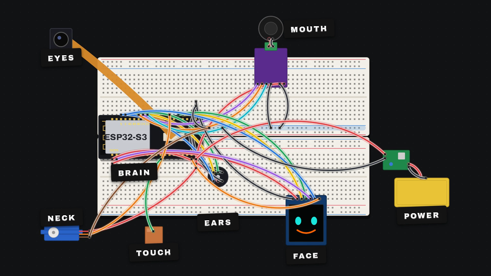

# Scrappy: an AI desk robot from a junk drawer

Scrappy is a small desk companion. It can **hear** you, **talk** back, **see** through a camera, show a **face** on a tiny screen, **turn its head**, and it knows when you **pat** it. It's built only from parts that were already in my junk drawer, on breadboards and jumper wires, with nothing new bought.

**Watch the build:** *(video link coming soon)*



> **What's here:** the parts list, the wiring, a **test program for every module**, an example personality file and a beginner prompt. The full Scrappy firmware and brain are coming later. Star the repo to get notified.

---

## How it works (simple version)

Scrappy's body is the **ears, eyes, mouth and face**. The thinking happens on a computer on your desk:

1. The ESP32 records your voice (and a photo when needed) and sends it over Wi-Fi.
2. The computer turns your speech into text, an AI model decides what to say, and a voice model speaks the answer.
3. The answer comes back to Scrappy's speaker, and its face and head react.

In my build, everything runs **locally**: Whisper for speech-to-text, Google's **Gemma** as the brain, and **Kokoro** for the voice. Nothing goes to the cloud.

---

## Components

All of these are small, cheap and easy to find. Use what you have; similar parts work too.

| Job | Part | Notes |
|---|---|---|
| Brain on the bot | **ESP32-S3 dev board, N16R8** (with a camera connector) | 16 MB flash, 8 MB PSRAM. Get a **pre-soldered** one if you can |
| Eyes | **OV5640** or **OV2640** camera | Plugs into the board's camera socket |
| Ears | **INMP441** I2S microphone | |
| Mouth | **MAX98357A** I2S amplifier + a small speaker (4–8 Ω, ~3 W) | The speaker connects through the amp's screw terminal |
| Face | **1.5" 128×128 SPI colour OLED** (SSD1351 driver) | 7 pins |
| Neck | **Micro servo** (SG90 / MG90S) | Turns the face left and right |
| Touch | A small square of **copper sheet** (~2 × 2 cm) + one wire | The head-pat sensor |
| Power | **3.7 V LiPo** (e.g. 2000 mAh) + **J5019** charger/boost board set to 5 V | Lets Scrappy leave the desk |
| Building | Breadboards (two full-size side by side, or four minis) + jumper wires | The ESP32 is too wide for one breadboard |
| Thinking | A computer on the same Wi-Fi | A gaming PC with an RTX 3060-class GPU is enough, or use a smaller model |

---

## Wiring

### Pin map

**Face: 1.5" SPI OLED**
| OLED pin | ESP32-S3 |
|---|---|
| VCC | 3V3 |
| GND | GND |
| SCL / SCK | GPIO 21 |
| SDA / MOSI | GPIO 47 |
| DC | GPIO 2 |
| CS | GPIO 14 |
| RES / RST | EN (resets with the board) |

**Ears: INMP441 mic**
| Mic pin | ESP32-S3 |
|---|---|
| VDD | 3V3 |
| GND | GND |
| L/R | GND |
| SCK | GPIO 42 |
| WS | GPIO 41 |
| SD | GPIO 1 |

**Mouth: MAX98357A amp**
| Amp pin | ESP32-S3 |
|---|---|
| VIN | 5V |
| GND | GND |
| BCLK | GPIO 40 |
| LRC | GPIO 39 |
| DIN | GPIO 38 |
| GAIN | GND (louder) |
| + / − | Speaker (screw terminal) |

**Neck: micro servo**
| Servo wire | ESP32-S3 |
|---|---|
| Red | 5V |
| Brown | GND |
| Orange | GPIO 45 |

**Touch: copper pad**
| Pad | ESP32-S3 |
|---|---|
| Wire soldered to one corner | GPIO 3 (touch pin) |

**Eyes: camera.** Plugs into the board's own camera socket, so there's no wiring.

**Power**
| From | To |
|---|---|
| LiPo + / − | J5019 BAT+ / BAT− |
| J5019 VOUT+ (set to 5.0 V) | ESP32 5V |
| J5019 VOUT− | ESP32 GND |

### Pins to avoid on this board
| GPIO | Why |
|---|---|
| 4–13, 15–18 | Used by the camera |
| 35, 36, 37 | Used by the PSRAM (N16R8) |
| 19, 20 | Native USB |
| 43, 44 | UART (the USB port you flash through) |
| 0, 46 | Boot / strapping pins |
| 48 | Onboard RGB LED |

### Tips
- **Two breadboards side by side.** The ESP32-S3 is so wide that one breadboard leaves no free holes on either side.
- **Use a power rail.** Use one rail for 3.3 V (OLED, mic) and another for 5 V (amp, servo), and label them with tape.
- **If you run out of GND holes,** use the breadboard's blue (−) side rail as an extra ground strip.
- **Never plug in USB and the battery at the same time.**
- **Don't trust a multimeter with a dying battery.** Mine showed the board getting far too much voltage, when it was really the meter's own battery running low.
- **Leave slack in the screen wires** so the neck can turn.
- **If the board resets when the servo moves,** give the servo its own 5 V supply with a shared ground.

---

## Build order

Build and test **one module at a time**. When something stops working, you'll know exactly which wire to check.

1. **Brain:** ESP32-S3 across two breadboards. Plug in USB and check that the light comes on.
2. **Power:** LiPo → J5019 (set to 5 V) → the 5V and GND pins.
3. **Ears:** the mic on the second breadboard, six wires. Test that it hears you.
4. **Mouth:** the amp and speaker. Play a test beep.
5. **Face:** the OLED, seven wires. Draw a face.
6. **Neck:** the servo. Turn the head left and right.
7. **Eyes:** plug in the camera and take a photo.
8. **Touch:** the copper pad on top of the head, on GPIO 3.
9. **Brain on your computer:** speech-to-text → AI model → voice, sent back over Wi-Fi.

---

## Test code (one sketch per module)

Each sketch tests **one** part on its own, so you know it's wired right before you add the next one. They're in `firmware/tests/`.

| Step | Sketch | What you should see |
|---|---|---|
| Brain | `pin_check` | Every pin Scrappy uses reads 3.3 V on a multimeter. A pin at 0 V has a bad solder joint |
| Ears | `mic_test` | A live voice-level bar in the Serial Monitor when you talk or clap |
| Mouth | `amp_test` | A little rising chirp every 3 seconds |
| Face | `oled_face` | Two cyan eyes and an orange smile that blink |
| Neck | `servo_test` | The head slowly looks left and right |
| Eyes | `cam_snap` | Send `s` and it returns a photo (`tools/grab_photo.ps1 COM3` saves it on Windows) |
| Touch | `touch_test` | The reading jumps and it prints "pat!" when you touch the copper |

**How to upload (Arduino IDE)**
1. Install the **esp32** boards package by Espressif (version 3.x) from the Boards Manager. No other libraries are needed.
2. Board: **ESP32S3 Dev Module**. Flash size: **16MB**. PSRAM: **OPI PSRAM** (the camera needs it).
3. Plug the USB-C into the board's **UART/COM** port, pick that port, then Upload.
4. Open the Serial Monitor at **115200** baud.

`examples/personality.md` shows how the robot's character is written: one short text file that the AI model reads before every reply.

---

## Beginner prompt

Paste this into your AI assistant (for example Claude) along with a **photo of your parts**:

```text
I'm a beginner and I want to build a small AI desk robot that can hear me, talk back,
show a face on a tiny screen, see with a camera and turn its head.

Here's a photo of the parts I have. Rules:
- Only use parts from this photo. I don't want to buy anything new.
- I'm building on breadboards with jumper wires.
- Go one module at a time: brain, power, ears, mouth, face, neck, eyes.
- For each module, tell me which pin goes where (as a simple table), how to test it,
  and what to check if it doesn't work.
- Keep your answers short and simple, and wait for me to say "done" before the next step.

First, tell me which parts from the photo you'd use for each job, and why.
```

**Good follow-ups:**
- "Show me where this goes on the breadboard, as a simple diagram."
- "It's not working. Here's a photo of my wiring. What's wrong?"
- "Which pins on my board should I avoid?"

---

## More

- Main channel: [Tech With Anant](https://www.youtube.com/@techwithanant-yt)
- How the AI behind Scrappy works: [Anant Explains](https://www.youtube.com/@anantexplainstech)
